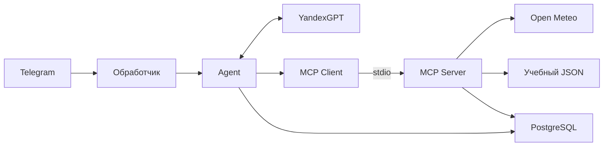

# Лабораторная работа 2

Ветка `lab2` продолжает `lab1`: собственный MCP 2.3 сервер stdio, три инструмента,
ресурс недели, подтверждение напоминаний и аудит. Telegram-команды и история lab1 сохранены.
Уведомления по расписанию в lab2 **не отправляются**.

## Запуск и конфигурация

Обновите зависимости командой `.venv\Scripts\python.exe -m pip install -r requirements-dev.txt`.
Запустите обычный start-скрипт из корня репозитория по README или `python -m app` из `.venv`.
Сервер запускается автоматически дочерним процессом с тем же Python; MCP-порт не открывается.
При сбое MCP обычные ответы доступны, запросы инструментов сообщают об отказе.

| Переменная | По умолчанию | Назначение |
|---|---|---|
| `SCHEDULE_PATH` | `data/schedule.json` | Доверенный путь к учебному JSON |
| `SCHEDULE_TIMEZONE` | `Europe/Moscow` | Зона недельного ресурса |
| `MCP_TIMEOUT` | `20` | Тайм-аут MCP-вызова в секундах |
| `WEATHER_TIMEOUT` | `10` | Тайм-аут погоды; максимум один повтор чтения |

Примеры без секретов находятся в `.env.example`. Расписание вымышленное: 14 дат 09–22.11.2026,
включая пустые выходные. Для другого периода замените даты и занятия с сохранением JSON-формата.
ФИО, номера групп и личные адреса не включайте. В Docker входят код и `data/*.json`;
конфигурация с секретами исключена.

Команды: `/tools`, `/timezone Europe/Moscow`, `/timezone`, `/why`.
Примеры: «Какая погода в Казани?», «Занятия на 12 ноября?», «Через два часа напомни сделать перерыв».
При нескольких городах укажите **город, страну, область** из предложенных вариантов.
Настройте `/timezone` до напоминания. Бот покажет точное время и кнопки. Согласие действует
300 секунд; отмена и изменение параметров требуют новой подготовки. До согласия создаётся
подготовленное действие, а не напоминание.

## Архитектура и данные



Миграции `Repository.initialize()` и `AgentRepository.initialize()` выполняют идемпотентный
DDL при запуске. Таблицы lab1 не удаляются. Новые таблицы: `lab2_profiles`, `lab2_actions`,
`lab2_reminders`, `lab2_audit`. Advisory-блокировка владельца, UNIQUE(chat_id, update_id)
и UNIQUE(action_id) исключают повторную подготовку и запись. Напоминание и завершение операции
фиксируются одной транзакцией. Отказ БД не превращается в успех.

Владелец берётся из приватного Telegram update. Модель передаёт только `text` и `remind_at`.
MCP metadata содержат HMAC capability на ID подтверждённого действия; ключ генерируется
приложением для дочернего процесса, не попадает в схему, LLM или файлы. Сервер извлекает владельца
из БД и сравнивает точные подтверждённые параметры. Независимый клиент без capability получает
отказ. Это локальная граница доверия stdio, не публичная HTTP-аутентификация.

YandexGPT `latest` проверен с native function calling. API запрещает совмещать `tools` и
`response_format`: сначала нативный выбор, затем при отсутствии вызова отдельный запрос
по JSON-схеме `TextDecision` для ответа/уточнения. Регулярные выражения не извлекают команды.
Snapshot `latest` не зафиксирован, будущие ответы могут отличаться.
Не более двух MCP-вызовов на сообщение; чтение передаётся в роли `tool` с источником.
Свободное объяснение модели не сохраняется: `/why` показывает программные причины выбора.
Полный текст сообщения, Telegram ID пользователя и секреты не попадают в текстовые логи.

## Тесты

Из корня проекта (Windows):

```powershell
.\.venv\Scripts\python.exe -m pytest -q
$env:RUN_INTEGRATION = '1'
.\.venv\Scripts\python.exe -m pytest -q
.\.venv\Scripts\python.exe -m ruff check .
.\.venv\Scripts\python.exe -m ruff format --check .
.\.venv\Scripts\python.exe -m pip check
```

На Linux/macOS активируйте `.venv`: `RUN_INTEGRATION=1 python -m pytest -q`.
Интеграционные тесты создают отдельные Docker-контейнеры, проверяют реальные конкурентные
транзакции и stdio MCP. Учебную БД не используют. Для обычного запуска удалите RUN_INTEGRATION.
Результат 11.11.2026: **122 passed**, включая четыре Docker/PostgreSQL-теста.

## Независимый клиент

```powershell
.\.venv\Scripts\python.exe -m scripts.lab2_inspect --live-weather
```

Создаёт отдельную БД, получает tools/list и resources/list, читает неделю и день, проверяет отказ
add_reminder без контекста; `--live-weather` добавляет настоящий Open-Meteo запрос.
Результат — `docs/lab2-mcp-check.json`. Используются стандартный mcp.Client и stdio-процесс,
без Agent, ToolGateway и Telegram. Проверено настоящее получение погоды.

Сквозной прогон обработчиков с настоящими LLM/MCP/БД и подменённым Telegram-транспортом:
`python -m scripts.lab2_smoke`. Результат — `docs/lab2-smoke.json`; два подтверждения
оставляют одно напоминание. Пользовательские данные и рабочая БД не используются.

Для MCP Inspector: команда `.venv` Python, аргументы `-m app.mcp_server`, рабочая папка — корень,
POSTGRES_* в окружении отдельной тестовой БД. **Не подключайте рабочую БД.**
Прямой add_reminder без доверенных metadata должен отклоняться. Секретные env не копируйте в отчёт.

## Эксперимент

Использует настоящий LLM API и его квоту. Напоминания не создаются, Telegram не вызывается:

```powershell
.\.venv\Scripts\python.exe -m scripts.lab2_evaluate --output docs/lab2-routing-new.json
```

Неизменённый набор — `docs/evaluation/lab2-routing.json`, источник и SHA-256 сохранены в результатах.
Фиксированные now=12.10.2026 09:00 +03:00, zone=Europe/Moscow применяются только к эксперименту.
Одна модель yandexgpt/latest, temperature=0.0, max_tokens=1000, без истории между запросами.
Схемы обнаруживаются по настоящему stdio MCP. Настоящие погодные запросы в оценке маршрутизации
не требуются: измеряется предложенное действие и его аргументы, а не изменчивая погода.

`lab2-routing-baseline.json`: **11/12** действий, **8/9** аргументов.
После добавления одного правила про относительные интервалы: **12/12** и **8/9**
в `lab2-routing-final.json`. Строгое сравнение: «Сделать перерыв» вместо «сделать перерыв»
отмечено несовпадением регистра. Оно не скрыто и не исправлено в сохранённых ответах.
Повтор исходного сбоя — `lab2-routing-retry.json`. Все файлы содержат полный запрос и ответ,
но не credentials. Результаты преодолевают порог ≥10/12 и ≥8/9.

## Ограничения

Текстовые ответы остаются вероятностными. Защита от prompt injection — разделение ролей,
ограниченные инструменты, запрет лишних аргументов и обязательное согласие перед изменением;
промпт сам по себе не даёт математической гарантии отказа от всех инъекций.
Нет отправки уведомлений, публичного HTTP MCP, автоматического переподключения после сбоя MCP.
После восстановления MCP перезапустите приложение. При повторной доставке ответа Telegram
возможен повтор текста, но не повтор напоминания. Старая история обрезается по правилам lab1.
